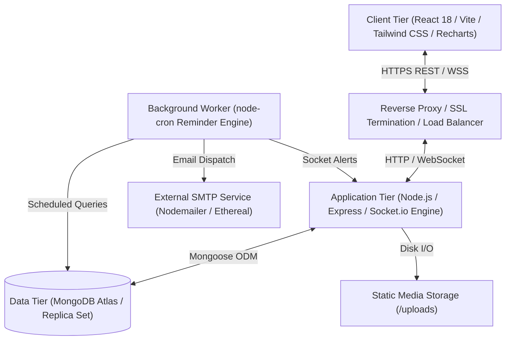
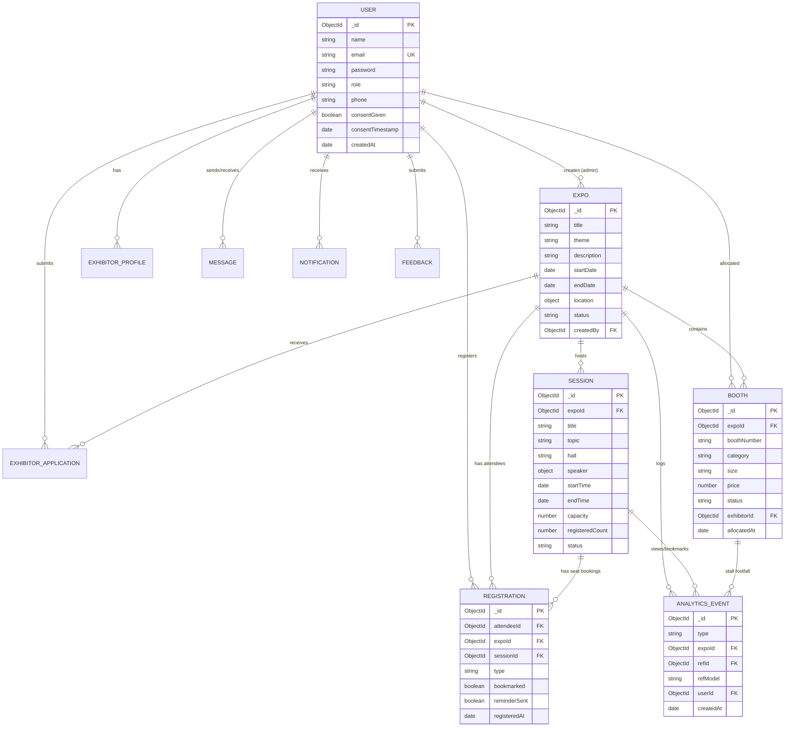
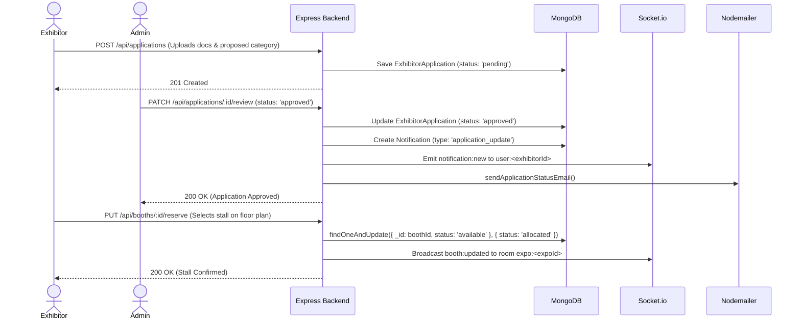
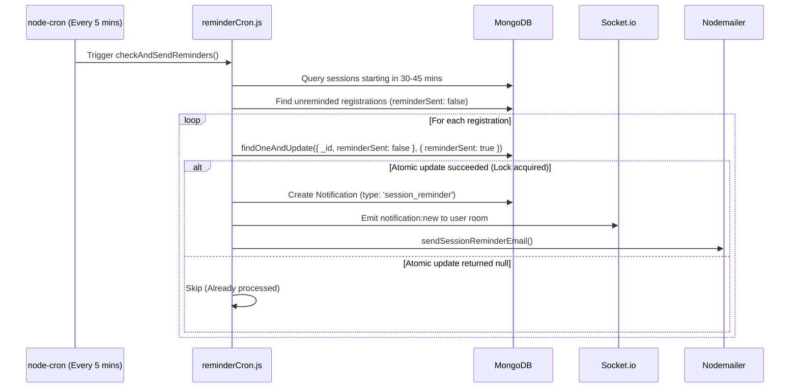
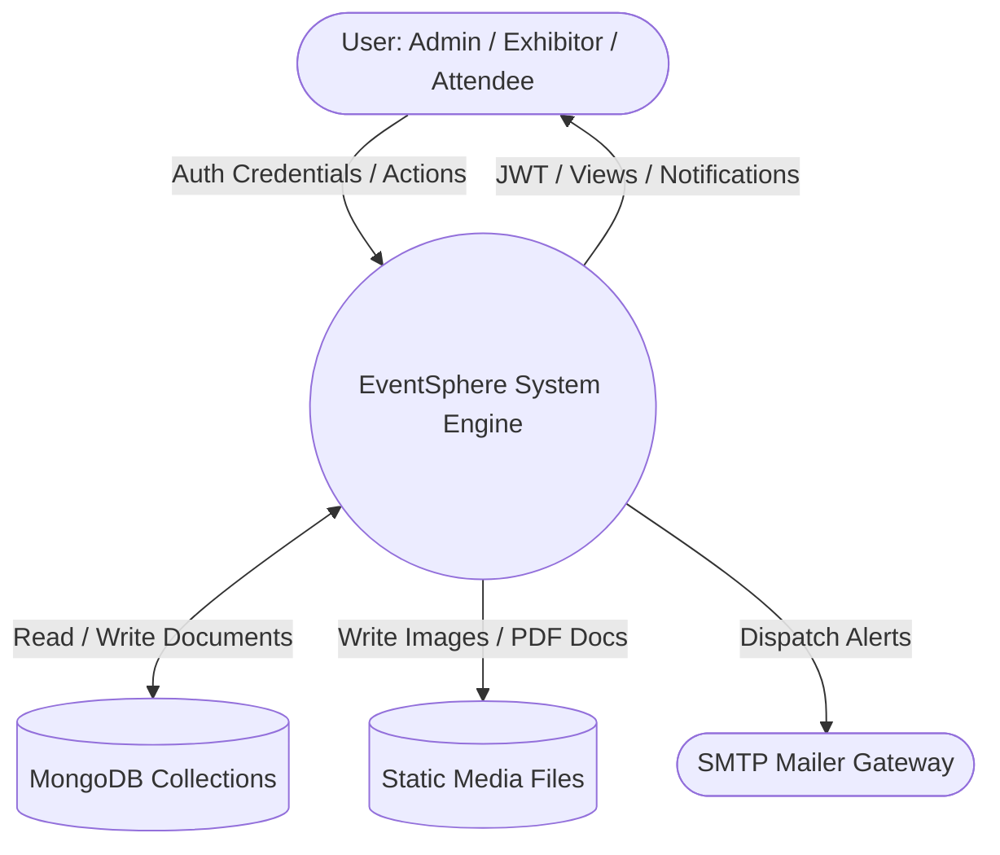

# EventSphere Management System — Project Specification & SRS Document

**Document Title:** Software Requirements Specification & Technical Architecture  
**Academic Program:** Aptech eProject 2026 Deliverable  
**System Name:** EventSphere Management System  
**Version:** 1.0.0 (Production Release)  
**Date of Submission:** November 18, 2026  

---

## 1. Project Introduction & Problem Statement

### 1.1 Executive Summary
Trade shows and commercial exhibitions represent multi-billion-dollar opportunities for commercial networking, product discovery, and knowledge dissemination. However, traditional physical event management relies heavily on fragmented legacy tools, paper applications, manual floor plan drafting, uncoordinated conference schedules, and disjointed communication channels.

**EventSphere Management System** is a full-stack, enterprise-grade virtualization and management suite built on the **MERN stack (MongoDB, Express, React, Node.js)** with **Socket.io** real-time communications. It bridges the divide between Event Organizers, Commercial Exhibitors, and Conference Attendees through interactive floor plans, automated stall allocations, conflict-free scheduling, live direct messaging, automated reminder crons, and executive analytics.

### 1.2 Problem Statement
Physical and hybrid trade exhibitions suffer from four fundamental operational bottlenecks:
1. **Inefficient Stall Allocations & Double-Booking Risks:** Manual spreadsheet tracking leads to allocation errors, delayed exhibitor contract reviews, and lack of visual stall transparency.
2. **Scheduling Clashes & Room Overcrowding:** Keynote presentations frequently suffer from hall double-booking and room capacity violations due to lack of real-time seat reservation enforcement.
3. **Fragmented Communication:** Exhibitors and attendees lack an integrated commercial networking channel, relying on external emails and business cards that get lost.
4. **Absence of Real-Time Analytics:** Event organizers lack live data on attendee footfall, stall popularity, and session turnout during active exhibitions.

### 1.3 Project Objectives
- Provide an interactive, responsive **SVG/CSS-driven Floor Plan** with live booth status updates via WebSockets.
- Deliver a transparent, multi-tier **Exhibitor Commercial Portal** for document verification, stall selection, and corporate profiles.
- Implement an automated **Schedule Conflict Detection Engine** enforcing hall time boundaries and attendee capacity limits.
- Establish an enterprise **Real-Time Messaging Hub** with strict role-based communication boundaries and typing indicators.
- Provide background **Automated Reminder Cron Jobs** guaranteeing exactly-once session notification delivery.
- Ensure strict **OWASP Top 10 Security** and **GDPR Privacy Compliance** (timestamped consent, data portability, right to erasure).

---

## 2. Software Requirements Specification (SRS)

### 2.1 Functional Requirements Matrix

| Ref ID | Feature / Capability | Description & Acceptance Criteria |
|---|---|---|
| **FR-01** | **Multi-Role Authentication** | Secure registration and login for Administrators, Exhibitors, and Attendees using bcrypt (salt rounds: 10) and stateless JWT tokens. |
| **FR-02** | **Exhibition Lifecycle** | Organizers create, edit, publish, and archive trade expos with venue locations, dates, themes, and banner assets. |
| **FR-03** | **Interactive Floor Plans** | Dynamic stall grid generator (rows × cols) and single-stall creator with category pricing (Standard, Premium, Corner, Island). |
| **FR-04** | **Commercial Applications** | Exhibitors submit company profiles and business documents (PDF/JPG); organizers review, approve, or reject with feedback. |
| **FR-05** | **Atomic Stall Reservation** | Approved exhibitors select and reserve vacant stalls with atomic double-booking prevention and real-time socket broadcasts. |
| **FR-06** | **Keynote Scheduling** | Hall conflict detection engine preventing overlapping bookings in the same hall; enforces expo date boundaries. |
| **FR-07** | **Attendee Seat Booking** | Attendees reserve keynote seats with atomic room capacity limit enforcement (`registeredCount < capacity`). |
| **FR-08** | **Real-Time Messaging Hub** | Socket.io direct messaging with presence indicators, typing broadcast, and role-based communication policies. |
| **FR-09** | **Notifications Engine** | In-app notification center and HTML transactional emails for application decisions, booth allocations, and schedule changes. |
| **FR-10** | **Session Reminders Cron** | `node-cron` scheduler running every 5 minutes scanning upcoming sessions (~30 min window) with exactly-once execution. |
| **FR-11** | **Executive Analytics** | Recharts-powered dashboard tracking footfall per stall, revenue realization, keynote fill rates, and CSV data exports. |
| **FR-12** | **GDPR Privacy Controls** | User consent tracking, Article 20 JSON data portability export, and Article 17 self-service account erasure. |

### 2.2 Non-Functional Requirements (NFR)
- **Security:** Helmet HTTP headers, NoSQL query sanitization (`express-mongo-sanitize`), XSS filters, Tiered IP rate-limiting, and strict upload MIME/extension whitelisting.
- **Performance:** Sub-100ms response times on typical queries, Gzip response compression, compound MongoDB indexing, and `.lean()` query optimizations.
- **Reliability:** Winston structured file rotation logging (`error.log`, `combined.log`) and `/api/health` monitoring database connectivity and memory usage.
- **Usability:** 100% responsive design across mobile (<640px), tablet (640-1024px), and desktop (>1024px) with WCAG 2.1 AA contrast compliance.

---

## 3. System Architecture & Engineering Diagrams

### 3.1 High-Level 3-Tier System Architecture

---

### 3.2 Entity-Relationship Diagram (ERD)

---

### 3.3 Sequence Diagram: Application Review & Booth Allocation

---

### 3.4 Sequence Diagram: Session Reminder Cron Execution

---

### 3.5 Data Flow Diagram (DFD Level 0 & Level 1)

---

## 4. Database Collections & Indexing Specification

The system is engineered on **10 MongoDB collections** adhering to third normal form principles where relational integrity is critical, and leveraging document embedding for high-throughput reads:

1. **`users`**: User identities, hashed credentials, roles (`admin`, `exhibitor`, `attendee`), phone, and GDPR consent timestamp.
   - *Indexes:* `{ email: 1 }` (unique), `{ role: 1 }`.
2. **`expos`**: Exhibition records, location venues, start/end dates, themes, and banners.
   - *Indexes:* `{ status: 1, startDate: 1 }`, text index `{ title: 'text', theme: 'text', description: 'text' }`.
3. **`booths`**: Commercial floor stalls, dimensions, pricing, categories, and allocation status.
   - *Indexes:* `{ expoId: 1, boothNumber: 1 }` (unique compound), `{ expoId: 1, status: 1 }`.
4. **`exhibitorapplications`**: Corporate participation applications, contact details, uploaded documentation URLs, and organizer review notes.
   - *Indexes:* `{ exhibitorId: 1, expoId: 1 }` (unique compound), `{ expoId: 1, status: 1 }`.
5. **`exhibitorprofiles`**: Commercial showcase profile, company bios, website, address, and product tags.
   - *Indexes:* `{ userId: 1 }` (unique).
6. **`sessions`**: Keynote presentations, speakers, hall assignments, timing, and room capacity.
   - *Indexes:* `{ expoId: 1, hall: 1, startTime: 1, endTime: 1 }`, `{ expoId: 1, startTime: 1 }`.
7. **`registrations`**: Expo attendee badges, keynote seat bookings, bookmark flags, and reminder dispatch flags.
   - *Indexes:* `{ attendeeId: 1, expoId: 1, sessionId: 1, type: 1 }` (unique compound).
8. **`messages`**: Direct communication records, sender/recipient references, text content, and read timestamps.
   - *Indexes:* `{ sender: 1, recipient: 1, createdAt: -1 }`.
9. **`notifications`**: In-app notifications, action links, read status, and timestamps.
   - *Indexes:* `{ userId: 1, read: 1, createdAt: -1 }`.
10. **`analyticsevents`**: Interaction tracking records (`page_view`, `booth_view`, `session_view`, `register`, `bookmark`).
    - *Indexes:* `{ expoId: 1, type: 1, createdAt: -1 }`, `{ expoId: 1, refId: 1, type: 1 }`.

---

## 5. REST API Endpoint Reference

| Method | Endpoint | Access Level | Description |
|---|---|---|---|
| `POST` | `/api/auth/register` | Public | Register new Attendee or Exhibitor with GDPR consent |
| `POST` | `/api/auth/login` | Public | Authenticate user credentials and issue signed JWT |
| `POST` | `/api/auth/forgot-password`| Public | Generate cryptographic reset token and dispatch email |
| `POST` | `/api/auth/reset-password/:t` | Public | Reset account password using token |
| `GET` | `/api/users/me` | Authenticated | Retrieve current user profile and consent metadata |
| `PATCH` | `/api/users/me` | Authenticated | Update user display name and contact phone |
| `GET` | `/api/users/me/export-data` | Authenticated | GDPR Article 20: Download full personal JSON archive |
| `DELETE`| `/api/users/me` | Authenticated | GDPR Article 17: Permanently delete account and purge data |
| `GET` | `/api/expos` | Public / Admin | List published exhibitions (or all expos for Admin) |
| `POST` | `/api/expos` | Admin | Create a new exhibition |
| `GET` | `/api/booths/expo/:expoId` | Public | Retrieve interactive floor plan stalls for an expo |
| `POST` | `/api/booths/bulk-generate`| Admin | Bulk generate matrix of floor plan booths |
| `PUT` | `/api/booths/:id/reserve` | Exhibitor | Atomically reserve available booth for approved company |
| `POST` | `/api/applications` | Exhibitor | Submit commercial application with certificates |
| `PATCH` | `/api/applications/:id/review`| Admin | Approve or reject exhibitor application |
| `GET` | `/api/sessions/expo/:expoId` | Public | List conference schedule for an exhibition |
| `POST` | `/api/sessions` | Admin | Create keynote with hall conflict detection |
| `POST` | `/api/registrations/session`| Attendee | Reserve seat in keynote session (capacity checked) |
| `POST` | `/api/messages` | Authenticated | Dispatch direct message (RBAC policy enforced) |
| `GET` | `/api/notifications` | Authenticated | Paginated in-app notifications with unread count |
| `GET` | `/api/analytics/overview` | Admin | Aggregate KPI overview across attendees, stalls, and revenue |
| `GET` | `/api/analytics/export` | Admin | Download audit report as CSV (overview, booths, sessions) |
| `GET` | `/api/health` | Public | Service health, DB state, uptime, and memory usage |

---

## 6. Hardware & Software Requirements

### 6.1 Development & Evaluation Environment
- **Operating System:** Windows 10/11, macOS 13+, or Ubuntu Linux 22.04 LTS
- **Node.js Runtime:** v18.x or v20.x LTS
- **Database Engine:** MongoDB Community Server v7.x/v8.x or MongoDB Atlas Cloud
- **Browser:** Google Chrome (v110+), Mozilla Firefox (v110+), Microsoft Edge (v110+), or Apple Safari (v16+)
- **System Memory (RAM):** Minimum 4 GB (8 GB recommended)
- **Disk Storage:** 500 MB free storage for dependencies, uploads, and database logs

### 6.2 Production Deployment Environment
- **Host Engine:** Docker / Containerized Linux (Alpine / Debian) or Linux VPS (Ubuntu 22.04)
- **Process Supervisor:** PM2 Cluster Mode (horizontal process balancing)
- **Reverse Proxy / SSL:** Nginx with Let's Encrypt TLS certificate
- **Database:** MongoDB Atlas M10+ Replica Set with automated snapshots
- **SMTP Gateway:** SendGrid, AWS SES, or Brevo SMTP relay
